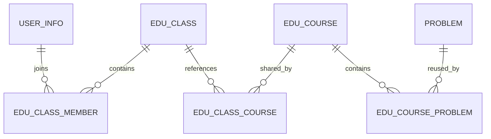

# 班级与共享课程：第一版设计

日期：2026-10-15。当前交付为设计方案，尚未创建业务表、修改应用或发布新版本。

## 1. 已确认的需求

- 在 Windows 本地开发，用自己的 GitHub 保存源码和版本，构建后发布到 ACR，再由 Ubuntu ECS 拉取运行。
- 一个学生可以属于多个班级。
- 一个班级可以添加多门课程，一门课程可以供多个班级使用。
- 课程关联题库中的题目。
- **共享课程、统一更新**：班级引用同一个课程 ID，不生成各班副本。课程标题、介绍、题目列表和排序保存后，引用它的班级在下一次读取时看到新内容。
- 原版运行、本地源码构建、ECS 发布及备份恢复已完成；用户已确认将 ECS 快照接入当前开发版后可使用。

其余权限、统计口径和第一版范围是下面明确列出的实施建议，不代表用户已逐项确认。题目是否需要班级专属可见正在单独确认；第一版暂按公开题库方案规划，该选择不改变共享课程关系。需要删除或隐藏的原功能尚无具体清单，另行整理，先完成教学功能。

## 2. 用户看到的行为

教师创建课程“C++ 基础”，包含题目 P1、P2。A 班和 B 班从课程库添加该课程，两个班都引用课程 C1。

教师在 C1 中增加 P3 并保存后，A 班和 B 班再次打开课程都能看到 P1、P2、P3。已经打开的页面需刷新或重新进入，第一版不做实时推送。

从 A 班移除 C1 只解除 A 班与 C1 的关联，B 班仍能使用。学生同时属于 A、B 班时，在“我的课程”只显示一次 C1，并显示来自哪些班级。退出 A 班后，如果仍属于 B 班，继续具有课程访问权。

学生原有提交记录保留。课程移除某道题，只解除课程与题目的关联；题库原题及判题记录继续保留。课程中的题目引用同一个题库 ID，题面或测试数据的维护仍使用原题库权限和操作入口。

## 3. 复用边界与实现选择

已检查的源码表明：[GroupMember](./hoj-springboot/api/src/main/java/top/hcode/hoj/pojo/entity/group/GroupMember.java) 有 `gid/uid` 关联；[Training](./hoj-springboot/api/src/main/java/top/hcode/hoj/pojo/entity/training/Training.java) 只有一个 `gid`；[TrainingProblem](./hoj-springboot/api/src/main/java/top/hcode/hoj/pojo/entity/training/TrainingProblem.java) 有 `tid/pid` 关联。[TrainingValidator](./hoj-springboot/DataBackup/src/main/java/top/hcode/hoj/validator/TrainingValidator.java) 和 `GroupTrainingManager` 使用单个团队归属判断访问和编辑权限，私有训练还有密码注册语义。

因此，第一版建议新增独立教学模块，复用 HOJ 的账号、题库、判题流程和可用页面组件。原团队和训练数据继续按其原有规则工作。这样可以为共享课程明确建立多班引用关系，避免让班级权限依赖旧训练的单个 `gid` 或密码注册规则。

新班级、新课程使用独立 ID；不把它们写入原提交对象的 `gid/tid/cid`。公开题目的提交继续使用 HOJ 普通题目提交路径。后续若支持课程专属题或课程内独立成绩，再新增明确的教学上下文和相应权限校验。

## 4. 数据关系

建议新增以下五张业务表。ID 沿用现有数据库的 `BIGINT UNSIGNED`，用户 ID 对应 `user_info.uuid` 的 `VARCHAR(32)`，题目 ID 对应 `problem.id`；建表时核对实际数据库的字符集、索引和关联类型。

| 表 | 主要字段 | 约束与用途 |
|---|---|---|
| `edu_class` | `id, name, description, owner_uid, status, gmt_create, gmt_modified` | 班级基本资料；状态为正常、归档 |
| `edu_class_member` | `id, class_id, uid, role, status, gmt_create, gmt_modified` | 唯一键 `(class_id, uid)`；角色为教师、学生；状态为有效、退出 |
| `edu_course` | `id, title, description, owner_uid, status, revision, gmt_create, gmt_modified` | 课程唯一内容；状态为草稿、发布、归档；`revision` 防止并发编辑覆盖 |
| `edu_class_course` | `id, class_id, course_id, sort_order, created_by, gmt_create` | 唯一键 `(class_id, course_id)`；只存引用和本班排序 |
| `edu_course_problem` | `id, course_id, pid, sort_order, gmt_create` | 唯一键 `(course_id, pid)`；只存题目引用和课程内顺序 |

为按用户查班级、按课程查引用班级、按课程查题目设置索引。涉及成员变更、添加课程和替换课程题目列表的操作使用事务，数据库唯一约束负责防止重复关联。

第一版使用归档管理班级和课程；不提供删除学生账号、题库原题或判题历史的级联操作。已被班级引用的课程不能直接退回草稿或归档：先明确处理引用关系，再改变发布状态。

## 5. 建议的角色与权限

“教师”是新增业务角色，由超级管理员授予，复用现有 `role/user_role` 存储；不因此获得 HOJ 网站管理、数据库或其他教师的班级权限。角色记录和授权缓存的刷新由迁移及账号管理入口处理。

| 操作 | 超级管理员 | 教师 | 学生 |
|---|---|---|---|
| 授予、撤销教师身份 | 可以 | 不可以 | 不可以 |
| 创建班级、课程 | 可以 | 可以 | 不可以 |
| 管理班级资料、成员、课程引用 | 全部班级 | 自己创建或被指定任教的班级 | 不可以 |
| 编辑共享课程及其题目列表 | 全部课程 | 课程创建者 | 不可以 |
| 从课程库引用已发布课程 | 可以 | 可以，目标须为自己管理的班级 | 不可以 |
| 查看课程内容 | 全部课程 | 自己课程及已发布课程库 | 通过有效班级成员关系获得访问权 |
| 查看班级学生的进度 | 全部班级 | 自己管理的班级 | 只看本人 |

授课教师可以引用其他教师发布的课程，但编辑权仍由课程创建者和超级管理员持有。课程创建者并不因此获得使用该课程的所有班级的学生管理权。

课程访问条件由后端统一判断：课程已发布，且用户属于至少一个未归档、仍引用该课程的班级；超级管理员和符合上表条件的教师另行授权。更换 URL、请求中的用户 ID、班级 ID 或课程 ID不能代替权限校验。前端隐藏按钮只用于交互。

第一版教师将已有账号加入班级；支持按明确账号搜索并批量添加，重复添加保持幂等。不把“选择已有账号”扩展为自动创建账号或分发密码。成员退出、教师身份撤销后，在下一次请求中重新校验权限；如果使用缓存，变更操作须同步失效缓存。

## 6. 题目可见性与进度口径

### 暂定方案：先引用公开题库

课程页面按班级限制访问，课程题目则引用 HOJ 现有公开、非团队专属题目。课程编辑接口只允许加入当前可公开访问的题目；比赛题、隐藏题、团队专属题不在该范围内。

这意味着公开题目仍可从公共题库访问。课程访问限制不会把公开题目自动变成班级私有题。读取课程时也须重新判断题目是否仍公开；若题库管理员改变权限，学生端隐藏该题内容，编辑端显示待处理项。

如果需要“课程题目也仅班内可见”，须单独补充课程题授权，并核对题面、附件、提交、记录、源码分享等所有相关读取路径后再交付，不能通过把隐藏题改成公开题来实现。

### 建议的第一版进度

按用户对“课程当前题目集合”的普通提交结果计算，排除比赛和原团队专属提交。每道题有 AC 才计为完成；OI 部分分不算 AC。历史 AC 可以复用，同一题出现在不同课程时不要求学生重复提交。

班级统计仅包含该班当前有效学生。一个学生同时属于两个班时，可以在各班分别出现，但同一课程中的题目不重复计数。空课程显示“暂无题目”，不显示 100%。

统一更新后，课程增加题目会改变完成率分母，删除题目也会改变当前统计。第一版不保存旧课程版本的成绩快照，也不根据共享课程修改自动重判旧提交。题目变为不可访问时，从学生可用题目和当前进度分母中排除，并在管理端提示维护。

## 7. 页面与操作流程

学生端新增“我的班级”和“我的课程”。班级详情展示班级介绍、课程列表；课程详情展示课程介绍、题目顺序及本人进度，进入题目后使用现有做题页面。

教师端新增“班级管理”和“课程库”。班级管理包含资料、成员、课程、学习进度；课程库包含我的课程、已发布课程，以及课程编辑、选题和排序。教师日常入口不放入要求网站管理员权限的 `/admin` 页面。

共享课程编辑页展示引用班级数量和名称，保存按钮写为“保存并同步到引用班级”。保存后统一更新，不额外为各班维护课程内容缓存副本；已有缓存按课程 ID 和 revision 失效。

“给班级添加课程”表示从课程库选择现有课程，属于引用操作。上传 Excel 导入学生、导入课程文件、自动创建学生账号、章节与视频、截止时间、作业分数和通知暂列后续需求。第一版先完成班级、共享课程和题目的完整流程。

## 8. 接口草案

新接口统一使用 `/api/edu` 前缀，沿用现有登录会话和响应格式。最终接口名以实现时的 API 文档为准。

| 接口 | 用途与关键校验 |
|---|---|
| `GET/POST /api/edu/classes` | 列出本人可见班级；创建班级要求教师或超级管理员 |
| `GET/PUT /api/edu/classes/{classId}` | 查看、修改班级；修改要求管理该班 |
| `GET/POST /api/edu/classes/{classId}/members` | 查看班级成员、批量加入已有账号 |
| `DELETE /api/edu/classes/{classId}/members/{uid}` | 标记退出，不删除账号和提交 |
| `GET/POST /api/edu/classes/{classId}/courses` | 查看本班课程、批量添加课程引用；只引用已发布课程 |
| `DELETE /api/edu/classes/{classId}/courses/{courseId}` | 解除本班引用，不删除课程 |
| `GET/POST /api/edu/courses` | 按身份返回可访问课程或创建课程；学生结果按课程 ID 去重 |
| `GET/PUT /api/edu/courses/{courseId}` | 查看课程、更新元数据及状态；更新验证所有者及 revision |
| `PUT /api/edu/courses/{courseId}/problems` | 一次提交完整题目顺序与预期 revision，在单个事务中替换关联并递增版本 |
| `GET /api/edu/courses/{courseId}/progress` | 本人进度；不因课程创建者身份泄露班级名单或他人源码 |
| `GET /api/edu/classes/{classId}/courses/{courseId}/progress` | 授课教师查看该班进度，同时检查班级管理权和课程引用关系 |

班级或课程创建者从登录身份取值，不接受客户端指定 owner_uid。批量操作先完整校验再写入，错误时返回清晰原因；课程题目包含重复 ID 或无权访问的题目时整体拒绝。并发编辑遇到 revision 不匹配时拒绝覆盖，提示重新读取。

## 9. 开发与发布顺序

1. **迁移和班级成员。** 新增版本化数据库迁移入口与记录表，完成教师授权、班级创建、成员加入和多班归属，并提供页面和后端越权测试。
2. **共享课程。** 完成课程库、题目选择、排序、班级引用及统一更新，验证移除引用和权限撤销。
3. **学习进度与回归。** 明确题目可见性后实现相应提交路径；验证正确代码 AC、错误代码 WA、课程去重和各班进度隔离。
4. **本地发布演练。** 用当前已恢复的数据测试升级，保留源码提交、镜像版本、数据库迁移版本、备份与验收记录。
5. **ECS 更新。** 本地验收通过才发布新标签，例如 `v0.2.0`；服务器先备份，再执行迁移、切换镜像并验证。实际 ECS 更新另行执行。

迁移脚本只增加教学模块所需表、索引和角色，保留原业务数据。每个脚本有版本、校验值和执行记录，失败时不把迁移标记为成功，也不假设 MySQL DDL 能整体事务回滚。上线执行增量迁移，不重新导入包含 DROP TABLE 的原始 `hoj.sql`。

旧应用回退时保留新增表；在确认结构兼容后才切换旧镜像。需要完整回到旧数据时，使用该版本更新前的备份并接受恢复点之后的数据变化。现有开发版导入工具会限制应用版本兼容性，不能作为跨版本数据库迁移工具。

## 10. 第一版验收用例

- 同一学生加入 A、B 两班，分别看到所属班级；未加入 C 班时不能通过改 URL 或接口参数访问其课程。
- A、B 两班引用同一课程，新增或重新排序一道题后，两班都得到相同的新列表；学生“我的课程”只显示一份。
- 移除 A 班引用后 B 班继续可用；学生退出 A 班但保留 B 班成员身份时仍能访问共享课程；退出所有相关班级后失去课程访问权。
- 课程创建者和超级管理员可编辑；引用课程的另一位教师能为自己的班级添加或移除引用，但不能修改共享课程内容。
- 两个编辑会话提交旧 revision 时，不覆盖已保存的新版本。
- 无关教师不能管理他人班级，课程创建者不能仅凭创建课程的身份查看其他班级的学生进度。
- 重复加入学生、重复引用课程不会产生重复记录；多题更新中的任一无效题目导致整次操作失败。
- 删除课程题目关联后，题库原题和历史提交仍在；课程或班级归档的访问规则生效。
- 普通题目提交继续得到 AC/WA；班级进度不混入比赛记录、其他学生记录或他班名单。
- 在原有账号、题目和提交仍存在的开发数据库上完成升级、重启、备份及恢复，回归旧题库、团队、训练和判题流程。

本文件是下一阶段实现依据；各开发阶段分别提交代码与验收结果。当前设计不等同于功能已经上线。
